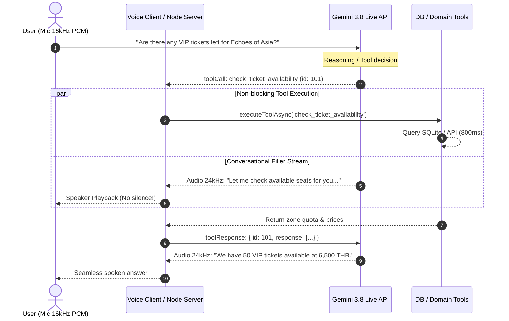

# Real-Time Voice Agent with Gemini Live API & Non-Blocking Function Calling

A production-ready real-time voice agent built with the **Gemini Live API** (`gemini-3.8-live` and `gemini-3.8-live-extended-thinking`), bidirectional WebSocket audio streaming, and **asynchronous non-blocking function calling** (`behavior: "NON_BLOCKING"`).

---

## 🌟 Key Architectural Capabilities

### 1. Non-Blocking Function Calling (`behavior: "NON_BLOCKING"`)
In traditional voice agents, the model halts speech output when a tool is called, creating uncomfortable silence while database or API queries execute. 

With Gemini Live API's **non-blocking execution model**:
1. When a tool is triggered, Gemini emits a `ToolCall` while **immediately continuing to stream spoken conversational fillers** (e.g. *"Let me look up the remaining VIP tickets for Echoes of Asia for you right now..."*).
2. The client processes the asynchronous tool in the background without blocking the incoming audio stream playback.
3. Once the tool finishes, the client dispatches `toolResponse`.
4. Gemini seamlessly incorporates the factual tool output into the ongoing speech flow.



---

### 2. Interaction Status Lifecycle (`gemini-3.8-live-extended-thinking`)
With extended thinking models, `turnComplete: true` no longer marks turn completion. Instead, the application monitors `interaction_status`:
- **`IN_PROGRESS`**: The model is actively reasoning, speaking conversational fillers, or awaiting asynchronous non-blocking tool responses.
- **`IDLE`**: All reasoning and background tool calls have concluded; the session is idle and ready for user voice input.

---

### 3. Real-Time Interruption & Barge-in Handling
When a user begins speaking while the agent is speaking:
1. Gemini's server-side Voice Activity Detection (VAD) detects speech.
2. The server emits `serverContent.interrupted: true`.
3. The client immediately stops all scheduled `AudioBufferSourceNode`s, clears the playback queue, and resets the scheduling clock to avoid overlapping audio or buffer delay.

---

## 📁 Directory Structure

```
gemini-live-agent/
├── server.js               # Standalone Node.js server (zero external dependencies)
├── mini-ws.js              # Native RFC 6455 WebSocket server implementation
├── gemini-live-service.js  # Gemini Live API WebSocket manager & tool dispatcher
├── tools.js                # Non-blocking tool declarations & DB integration
├── gemini_live_agent.py    # Python implementation with google-genai SDK (>= 2.3.0)
├── public/
│   └── index.html          # Interactive Web Audio Voice Dashboard (16kHz in, 24kHz out)
└── README.md               # Documentation and guides
```

---

## 🚀 Quick Start

### Option A: Interactive Web Voice Dashboard (Node.js)

1. Set your Gemini API key:
   ```powershell
   $env:GEMINI_API_KEY="your-gemini-api-key"
   ```
2. Start the Voice Agent server:
   ```bash
   node gemini-live-agent/server.js
   ```
3. Open your browser at **`http://localhost:3000`**.
4. Click the central **Microphone button** to initiate the live session and speak directly to the voice concierge!

---

### Option B: Python Backend Agent (`google-genai` SDK)

1. Ensure `google-genai` is installed:
   ```bash
   pip install -U google-genai
   ```
2. Set your environment variable:
   ```bash
   export GEMINI_API_KEY="your-gemini-api-key"
   ```
3. Run the agent script:
   ```bash
   python gemini-live-agent/gemini_live_agent.py
   ```

---

## 🛠️ Tool Specifications

### `check_ticket_availability`
- **Behavior**: `NON_BLOCKING`
- **Parameters**: `event_name` (string, required), `zone` (string, optional)
- **Description**: Queries concert quotas and pricing from the local SQLite ticketing database (`backend/db.js`).

### `calculate_booking_quote`
- **Behavior**: `NON_BLOCKING`
- **Parameters**: `event_name` (string), `zone` (string), `ticket_count` (integer), `promo_code` (optional)
- **Description**: Computes subtotal, validates promo codes (e.g. `EARLYBIRD`), applies 7% VAT, and calculates final total.

### `lookup_reservation_status`
- **Behavior**: `NON_BLOCKING`
- **Parameters**: `order_ref` (string, required)
- **Description**: Verifies customer payment status and QR code readiness.

---

## 💡 Best Practices for Gemini Live Voice Applications

1. **Use Headphones**: When testing microphone input to avoid acoustic feedback and unintended self-interruption.
2. **Audio Sample Rates**:
   - Send input audio at **16,000 Hz** 16-bit PCM mono (`audio/pcm;rate=16000`).
   - Play received audio at **24,000 Hz** 16-bit PCM mono.
3. **Always Process All Event Parts**: A single server turn may contain multiple audio chunks and transcript pieces simultaneously.
4. **Flush Queues on Interruption**: Purge playback buffers as soon as `interrupted: true` arrives.
5. **Set `behavior: "NON_BLOCKING"`**: Always declare functions as non-blocking when low-latency dialogue is critical.
